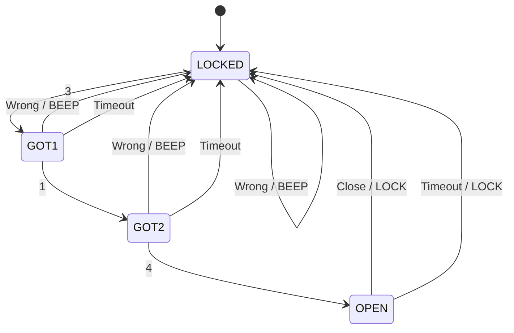

# Homework 5 - Combination Lock

ECE 361 - Fall 2026

## Description
This program simulates a combination lock using a finite state machine (FSM).

The correct code is 3-1-4.

A wrong digit resets the lock and makes a beep. The lock also resets after a timeout.

## Build
Run:
make

## Run
Run:
echo "314" | ./lock

## Test
Run:
make test

## Clean
Run:
make clean

## States
- LOCKED: The lock is closed.
- GOT1: The first digit is correct.
- GOT2: The first two digits are correct.
- OPEN: The lock is open.

## State Diagram

LOCKED --3--> GOT1

GOT1 --1--> GOT2

GOT2 --4--> OPEN

Wrong digit: Go to LOCKED (BEEP).

Timeout: Go to LOCKED.

OPEN + Close: Go to LOCKED.

## Transition Table

| State | RIGHT | WRONG | CLOSE | TIMEOUT |
|---|---|---|---|---|
| LOCKED | GOT1/NONE | LOCKED/BEEP | LOCKED/NONE | LOCKED/NONE |
| GOT1 | GOT2/NONE | LOCKED/BEEP | GOT1/NONE | LOCKED/NONE |
| GOT2 | OPEN/UNLOCK | LOCKED/BEEP | GOT2/NONE | LOCKED/NONE |
| OPEN | OPEN/NONE | OPEN/NONE | LOCKED/LOCK | LOCKED/LOCK |

